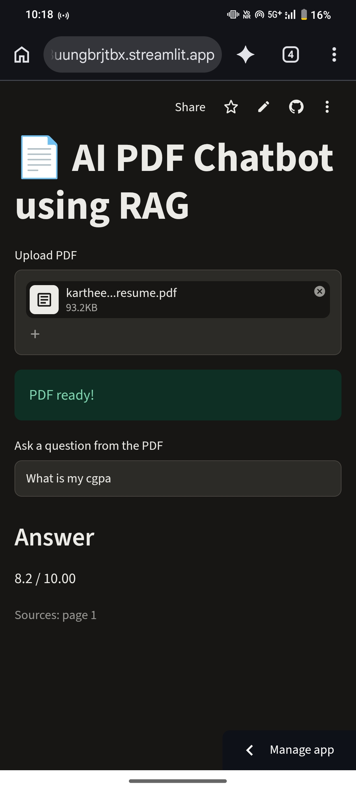
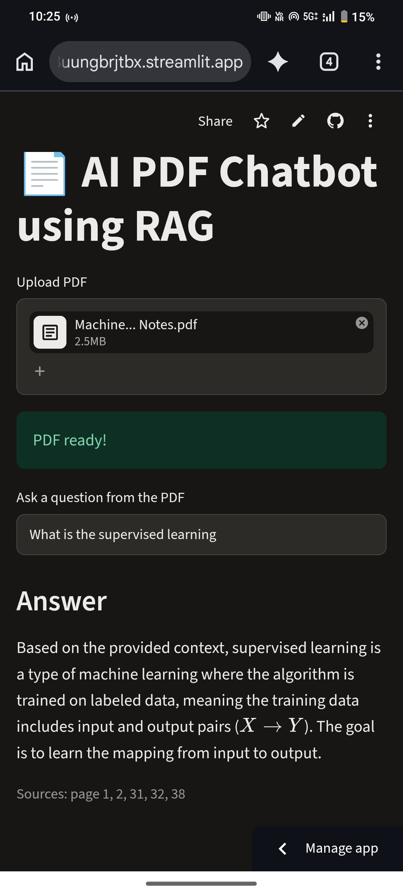

# 🤖 AI PDF Chatbot using RAG

🔗 **Live Demo:** https://ai-pdf-chatbot-rag-q2o3jsv6rke8uungbrjtbx.streamlit.app/

> Upload any PDF and ask questions in plain English. The app retrieves the most relevant parts of the document and uses **Google Gemini** to answer from them, with **page-number sources** under every answer.

---

## 📌 Overview

Reading long PDFs manually takes time. This app uses **Retrieval-Augmented Generation (RAG)**: instead of sending the whole document to the LLM, it finds only the passages relevant to your question and gives those to Gemini as context. That keeps answers grounded in the document and reduces made-up information.

## ✨ Features

- 📤 Upload any text-based PDF
- 🔍 Semantic search with a FAISS vector store
- 🧠 Answers generated by **Gemini 3.5 Flash**, using only the retrieved context
- 📑 **Page citations** shown under each answer
- 🚫 Replies "I couldn't find that in the PDF" when the answer isn't in the document
- ⚡ Index and embedding model are cached, so follow-up questions are fast
- ☁️ Deployed on Streamlit Cloud

## 🏗️ How It Works

```
PDF Upload
   ↓
PyPDFLoader → extract text page by page
   ↓
RecursiveCharacterTextSplitter → chunks (1000 chars, 150 overlap)
   ↓
HuggingFace all-MiniLM-L6-v2 → embeddings
   ↓
FAISS → vector index
   ↓
User question → top 5 similar chunks
   ↓
Gemini 3.5 Flash + prompt → answer from context only
   ↓
Answer + source pages shown in Streamlit
```

## 🛠️ Tech Stack

| Component | Technology |
|---|---|
| UI | Streamlit |
| PDF loading | LangChain `PyPDFLoader` (pypdf) |
| Chunking | `RecursiveCharacterTextSplitter` |
| Embeddings | HuggingFace `all-MiniLM-L6-v2` |
| Vector store | FAISS |
| LLM | Google Gemini 3.5 Flash (`google-genai` SDK) |
| Hosting | Streamlit Cloud |

## 🖼️ App Screenshot




## ▶️ Run Locally

**1. Clone the repo**
```bash
git clone https://github.com/kartheek-r/ai-pdf-chatbot-rag.git
cd ai-pdf-chatbot-rag
```

**2. Create a virtual environment**
```bash
python -m venv venv

# Windows
venv\Scripts\activate

# Mac/Linux
source venv/bin/activate
```

**3. Install dependencies**
```bash
pip install -r requirements.txt
```

**4. Add your API key**

Get a free key from [Google AI Studio](https://aistudio.google.com/), then create `.streamlit/secrets.toml`:
```toml
GOOGLE_API_KEY = "your_key_here"
```
(Or set it as an environment variable named `GOOGLE_API_KEY`.)

**5. Run**
```bash
streamlit run streamlit_app.py
```

## ☁️ Deploy on Streamlit Cloud

1. Push the repo to GitHub
2. Go to [share.streamlit.io](https://share.streamlit.io) → **Create app**
3. Select this repo, branch `main`, main file `streamlit_app.py`
4. Under **Advanced settings → Secrets**, add `GOOGLE_API_KEY = "your_key_here"`
5. Deploy

## ⚠️ Limitations

- Works with text-based PDFs only (scanned PDFs need OCR)
- Handles one PDF at a time, with no chat memory between questions
- Answer quality depends on chunking and retrieval, so very broad questions may miss details

## 🔮 Future Improvements

- Multiple PDF support and chat history
- Hybrid search (BM25 + vectors) and reranking
- Evaluation set to measure answer accuracy
- Chroma or Qdrant as a persistent vector database

## 👨‍💻 Author

**Ryalampadu Kartheek**
[LinkedIn](https://www.linkedin.com/in/kartheek-ryalampadu) · [GitHub](https://github.com/kartheek-r)
